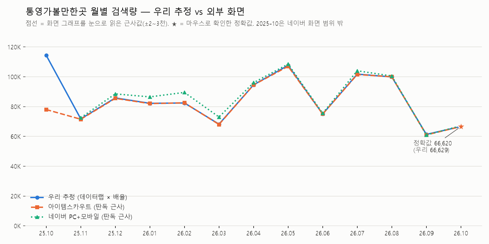

# 작업기록 — 설계 메모 · 핵심 구간 해설

단위별로 아래에 누적합니다. 실행 방법은 [README](../README.md)를 봅니다.

## 작업 단위 진행표
| 단위 | 내용 | 상태 |
|---|---|---|
| U0 | 저장소·브랜치·가상환경·`.gitignore`, 계정·키 준비 | 완료 |
| U1-a | 검색광고 API — 65개 키워드 최근 30일 검색수 수집 | 완료 |
| U1-b | 데이터랩 — 키워드 65개 + 그룹 6개 일간 지수 수집 | 완료 |
| U1-c-1 | 시리즈 71개 환산 배율 계산·검증 | 완료 |
| U1-c-2 | 결과물: 그룹 주간 CSV·월별 표·검증 그래프·요약 | 완료 |
| U2 | FastAPI 뼈대(라우터/서비스 분리), CORS | 완료 |
| U3-1 | Firestore 연결 확인 | 완료 |
| U3-2 | Pydantic 스키마 + 데이터 CRUD | 완료 |
| U3-3 | U1 결과 1,794건 Firestore 적재 | 완료 |
| U4-1 | `/api/data/summary` | 완료 |
| U4-2 | ★`/api/data/statistics` | 대기 |
| U5 | Render 첫 배포 | 대기 |
| U6 | 대화 기록 API | 대기 |
| U7 | `/api/chat` 컨텍스트 주입 + 자동 저장 | 대기 |
| U8 | ★Function Calling | 대기 |
| U9~U11 | 프론트: 채팅 / 데이터 관리·요약 / 대화 기록 | 대기 |
| U12 | ★그래프·내보내기·다크 모드 | 대기 |
| U13 | Vercel 배포 + API 주소 연결 | 대기 |
| U14 | ★MCP 또는 GPT Actions 연동 | 대기 |
| U15 | README 완성 + 스크린샷 | 대기 |

★ = 보너스

---

## U0. 준비 단계

### 설계 의도·기술 선택 근거
| 결정 | 이유 | 버린 것과 버린 이유 |
|---|---|---|
| 새 저장소 `Codyssey_Mission_03_ai` | 배포처 2곳·키 4종이 얽혀 A3-01과 섞이면 관리가 어려움 | `Codyssey_Mission_03/Project_02` → 한 레포에 두 미션의 배포 설정이 섞임 |
| 폴더 3분할 (`data_pipeline` / `backend` / `frontend`) | 배포처마다 필요한 폴더만 올림 → 서버에 수집용 키를 넣을 이유가 없어짐 | 한 폴더에 전부 → 배포 용량 증가, 키 노출 범위 확대 |
| 브랜치 `feature/ai-assistant` (main에서 분기) | main은 최초 상태 유지. 제출 시 레포 URL + 이 브랜치명 등록 | main 직접 작업 → 되돌릴 기준점이 없어짐 |
| Python 3.14 | Render 새 서비스 기본값(3.14.3)과 일치 → 로컬·서버 버전 차이로 인한 오류 감소 | 3.10 → 서버와 버전 차이 |
| `.gitignore`를 키보다 먼저 커밋 | 키가 생기기 전에 막아야 실수할 틈이 없음 | 키 발급 후 작성 → 그 사이 `git add` 시 바로 공개 |
| 키워드 목록·수집 원본 비공개 | 브랜드명 노출 방지 | 전부 공개 → "브랜드 키워드" 표기가 무의미. 대가: 수집 단계는 재현 불가, 그룹 단위 CSV부터 재현 가능 |
| Firestore: Standard / 서울(asia-northeast3) / 프로덕션 모드 | DB 접근 주체는 서버뿐이고, 서버는 Admin SDK(관리자 권한)로 접속해 보안 규칙을 거치지 않음 → 외부 직접 접근은 전부 차단(`allow read, write: if false;`) | 테스트 모드 → 30일간 누구나 읽기·쓰기 가능 |
| Firebase 키: 레포 밖 폴더 + 경로 방식 | ① 방어선 2겹(레포 밖 + `.gitignore`) ② 로컬·Render 모두 "경로의 파일 읽기" 한 방식(Render Secret Files) ③ 바탕화면 아래를 피해 OneDrive 동기화 회피 | 레포 안 보관 → 방어선 1겹. `.env` 한 줄 → JSON 변환 중 깨지기 쉬움 |
| OpenAI 선불 5달러 + 월 한도 10달러 | 과금 상한을 처음부터 고정 | 후불·무제한 → 반복 호출 버그 시 비용 폭주 |

### 다음 단위에 영향을 주는 사항
- 검색광고 API의 "최근 30일"은 조회 시점 기준이다. 2026-11-07 기준 약 10/8~11/6로, 저장 기간(2021-01-01~2026-09-30)과 겹치지 않는다.
- 따라서 데이터랩은 배율 계산용으로 **조회 전날까지** 받아 같은 30일 구간에서 배율을 구하고, 저장은 **9/30까지만** 잘라서 한다. (U1-b에 반영)

### 핵심 구간 해설 — `.gitignore`
**`.venv/`를 올리지 않는 이유**
가상환경 안의 `pyvenv.cfg`에는 `home = C:\Users\my\AppData\...`처럼 내 컴퓨터 경로가 박혀 있다. 다른 컴퓨터에서는 쓸 수 없고 용량도 크다. 그래서 가상환경 대신 "설치할 패키지 목록(requirements.txt)"을 올리고, 받는 사람이 직접 만든다.

**`.env` → `*.env` → `!.env.example` (순서가 중요)**
- `*`는 "아무 글자나". `*.env`는 `backend.env`처럼 끝이 `.env`인 파일도 막는다.
- `!`는 "예외". 앞에서 막은 것 중 `.env.example`(키 이름만 적힌 견본)은 올린다.
- `.gitignore`는 위에서 아래로 읽고 **뒤의 줄이 앞의 줄을 덮어쓴다**. 그래서 `!` 줄은 막는 줄보다 아래에 있어야 한다.

**`*firebase-adminsdk*.json`**
양쪽 `*` → "이름 중간 어디든 firebase-adminsdk가 들어간 json". 실제 받은 파일(`codyssey-mission-03-ai-firebase-adminsdk-fbsvc-….json`)이 이 패턴에 걸린다. 키 파일은 레포 밖에 있으므로 이 줄은 두 번째 방어선이다. 실수로 레포 안에 복사해도 막힌다.

**`data_pipeline/raw/` (끝의 `/`)**
끝에 `/`가 있으면 "이 이름의 폴더와 그 안의 모든 것". 수집 원본이 몇 개가 생기든 폴더째 막힌다.

---

## U1-a. 검색광고 API — 키워드별 최근 30일 실제 검색수

### 설계 의도·기술 선택 근거
| 결정 | 이유 | 버린 것과 이유 |
|---|---|---|
| 검색광고 API의 30일 실제값을 **환산 기준점**으로 사용 | 데이터랩은 상대 지수만 줘서 절대값을 알 수 없음 | 상대 지수 그대로 → 직관적이지 않음. 상용 서비스식 누적 → 수년치 기록이 없어 재현 불가 |
| `.env` 폴더별 분리 | 프로그램마다 자기 키만 봄(최소 권한), Render가 `backend/`만 가져가는 구조와 일치 | 루트 하나 → 서버가 쓰지 않는 검색광고 키까지 읽을 수 있음 |
| requests + python-dotenv, 서명은 기본 기능 `hmac` | 원리가 걸린 서명은 눈에 보이게, 나머지는 검증된 도구로 짧게 | 기본 기능만 → 핵심과 무관한 코드 20~30줄 증가 |
| 5개씩 13회 + 0.5초 대기 | 한 번에 5개가 API 상한, 초당 3회 이상이면 429 오류 | — |
| 실패 시 **중단** | 한 묶음이라도 빠지면 그룹 합계와 배율이 조용히 틀어짐 | 건너뛰기 → 틀린 결과가 그럴듯하게 나옴 |
| 보낸 키워드만 **골라 담기**(`normalize`) | 응답에 연관 키워드 수백 개가 섞이고, 표기가 바뀌어 돌아올 수 있음 | — |
| `< 10`은 **원본 그대로** 저장 | 변환 규칙은 데이터를 보고 U1-c에서 결정. 실제 4개, 영향은 브랜드 그룹 기준 최대 0.3% | 수집 단계에서 숫자로 바꿈 → 근거 없이 결정됨 |
| 수집일 기록 + 파일명에 날짜 | "최근 30일"은 조회일에 따라 바뀜 → 데이터랩 구간을 맞추는 기준 | — |

### 실행 결과
- 2026-11-07 수집, 65/65 찾음, `< 10` 4개
- 9월 기준 아이템스카우트 값(예: 통영호텔 11,170)보다 작은 것(6,650)은 조회 구간이 성수기(9월) → 비수기 진입(10월 초~11월 초)으로 바뀐 영향으로 해석

### 다음 단위에 넘기는 결정
- 키워드 단위 월별 추정도 생성(비공개 `raw/`에만), 서비스에는 그룹 단위만 사용
- 데이터랩은 키워드별 65회 + 그룹별 6회 요청 → "키워드 합계 vs 그룹 직접 추정" 자체 점검 가능
- 네이버 검색광고 화면의 월별 추이(최근 1년)와 추정 월별을 비교 검증

### 핵심 구간 해설 — `collect_searchad.py`
**① 서명 만들기**
```python
message = f"{timestamp}.{method}.{uri}"
digest = hmac.new(secret_key.encode("utf-8"), message.encode("utf-8"), hashlib.sha256).digest()
return base64.b64encode(digest).decode("utf-8")
```
- 비밀키는 보내지 않고, 비밀키로 "시각.요청종류.주소"를 섞어 만든 **일회용 도장**만 보낸다. 네이버가 같은 방식으로 도장을 다시 만들어 일치하면 진짜 요청으로 인정한다.
- `hmac`(sha256)은 되돌릴 수 없게 섞는다 → 도장만 보고는 비밀키를 알 수 없어 인터넷으로 보내도 안전하다.
- `.encode("utf-8")`: 섞는 기계는 글자가 아닌 바이트만 받는다. `base64`: 섞은 바이트를 요청에 실을 수 있는 문자열로 바꾼다.
- `uri`에는 `?hintKeywords=...`를 넣지 않는다. 네이버 규칙상 경로 부분만 서명한다.

**② 시각을 매번 새로 잰다**
```python
timestamp = str(int(time.time() * 1000))
```
시각이 도장에 섞이므로 요청마다 도장이 달라진다 → 지난 요청을 복사해 다시 보내도 거부된다. 같은 이유로 컴퓨터 시계가 크게 틀리면 정상 요청도 거부될 수 있다.

**③ 실패하면 멈춘다**
```python
if response.status_code != 200:
    sys.exit(1)
```
5개 묶음 하나가 빠진 채 진행하면 그룹 합계가 작아져 배율이 조용히 틀어진다. 틀린 결과가 그럴듯하게 나오는 것보다 멈춰서 알리는 쪽이 안전하다.

**④ 보낸 키워드만 골라 담는다**
```python
wanted = {normalize(k) for k in batch}
for item in items:
    if normalize(item["relKeyword"]) in wanted: ...
```
응답에는 연관 키워드 수백 개가 섞여 온다. 네이버가 표기를 바꿔 돌려줄 수 있어(띄어쓰기 등) 양쪽에 같은 `normalize`를 적용해 비교한다.

**⑤ 경로를 "이 파일 위치" 기준으로 잡는다**
```python
BASE_DIR = Path(__file__).resolve().parent
```
터미널이 어느 폴더에 있든 `data_pipeline` 안의 `keywords.csv`·`.env`를 찾는다.

---

## U1-b. 데이터랩 — 키워드 65개 + 그룹 6개 일간 검색 지수

### 설계 의도·기술 선택 근거
| 결정 | 이유 | 버린 것과 이유 |
|---|---|---|
| **일간** 단위로 수집 | 주·월은 일간을 더해 정확히 만들 수 있음, 검색광고 30일 구간과 날짜 단위로 맞출 수 있음 | 주간 직접 수집 → 달을 걸치는 주 때문에 월 합계 부정확, 30일 구간 맞추기 불가 |
| 시리즈마다 **따로 요청**(71회) | 시리즈마다 최대값이 100 → 작은 키워드도 숫자가 뭉개지지 않음. 배율을 시리즈마다 따로 구하므로 기준이 달라도 무방 | A3-01식 한 번에 요청 → 같은 기준 비교에는 맞지만, 큰 키워드에 눌려 작은 키워드가 0.0x 수준이 됨 |
| 기간 끝 = **실행 전날 자동 계산** | 검색광고 30일 값과 같은 날 기준을 맞추기 위함 | 날짜 고정 → 다른 날 재실행하면 어긋남 |
| **긴 표** CSV + 원본 JSON | 시리즈별 계산에 바로 쓰는 모양, 빠진 날이 "줄 없음"으로 보존됨 | 넓은 표 → 빈칸의 의미가 모호해지고 pandas 필요 |
| 실패 시 중단, 빠진 날은 원본 그대로 | U1-a와 같은 원칙. 처리 규칙은 개수를 본 뒤 U1-c에서 결정 | — |

**A3-01과 반대로 쓴 이유:** A3-01은 세 지역을 같은 100 기준으로 비교하려고 "한 번에" 요청했다. 이번에는 시리즈마다 실제 검색수로 따로 환산하므로, 기준을 맞출 필요가 없고 오히려 따로 받아야 정밀도가 산다. 같은 API를 목적에 따라 반대로 쓴 사례다.

### 실행 결과
- 2026-11-07 수집, 71/71 성공, 121,785줄
- 그룹 6개: 빠진 날 0, 마지막 날 모두 2026-11-06
- 키워드 65개: 빠진 날 0인 키워드 18개, 50% 이상 빠진 키워드 13개(대부분 검색광고 30일 값이 작은 키워드. 예: 통영숙소예약 30일 70회 → 2,136일 중 261일만 받음)
- 자체 점검: `group 대형 키워드` = `keyword 통영가볼만한곳` (받은 날·빠진 날·최대일·마지막 날 일치)
- 최대값 날짜가 연휴·성수기에 몰림(2021-10-09 한글날 연휴, 2023-10-01 추석 연휴, 2025-05-03 어린이날 연휴, 2022-08-01 여름 휴가철) → 데이터가 현실 패턴과 맞음
- **해석:** 작은 키워드는 하루 검색이 적어 데이터랩이 날짜를 빼고 보낸다 → 키워드 단위 추정은 신뢰가 낮다. 그룹으로 묶으면 매일 값이 생겨 이 문제가 사라진다(그룹 직접 보정 설계의 근거).

### 핵심 구간 해설 — `collect_datalab.py`
**① 시리즈 71개 만들기**
```python
series = [("keyword", row["keyword"], [row["keyword"]]) for row in rows]
groups = {}
for row in rows:
    groups.setdefault(row["group_name"], []).append(row["keyword"])
series += [("group", name, keywords) for name, keywords in groups.items()]
```
데이터랩은 항상 "묶음" 단위로 받으므로 키워드도 1개짜리 묶음으로 만든다. `setdefault`는 그룹 칸이 없으면 빈 목록을 만들고 있으면 거기에 추가한다 → 그룹 목록을 코드에 적지 않아 `keywords.csv`만 고치면 그룹 구성이 따라 바뀐다.

**② 요청 한 번에 시리즈 하나만**
```python
"keywordGroups": [{"groupName": name, "keywords": keywords}],
```
목록에 1개만 넣어 시리즈마다 자기 최대값이 100이 되게 한다.

**③ 기간 끝을 실행 전날로 자동 계산**
```python
end_date = (date.today() - timedelta(days=1)).isoformat()
```
검색광고 30일 값이 조회일 기준이라 같은 기준에 맞춘다. 오늘 데이터는 하루치가 다 모이지 않아 전날까지만 받는다.

**④ 빠진 날 세기**
```python
summary.append((kind, name, len(data), total_days - len(data), peak, last))
```
전체 일수 − 응답에 들어 있는 날짜 수 = 데이터랩이 빼고 보낸 날 수. 마지막 날짜도 함께 확인해 30일 구간 계산에 영향이 있는지 본다.

---

## U1-c-1. 환산 배율 계산·검증

    배율 = (검색광고 '최근 30일' 실제 검색수) ÷ (같은 30일의 데이터랩 지수 합계)

**전제(3안 전체의 가정):** 데이터랩 지수는 실제 검색 횟수를 최대값 100에 맞춰 같은 비율로 줄인 값이다. 그래서 30일 한 구간에서 구한 비율(배율)을 전체 기간에 똑같이 적용할 수 있다.

### 설계 의도·기술 선택 근거
| 결정 | 이유 | 버린 것과 이유 |
|---|---|---|
| 30일 구간 = 수집일 **전날까지 30일** + 민감도 기록 | 네이버가 정확한 날짜를 공개하지 않음 → 가장 자연스러운 해석을 쓰고, 불확실성은 숫자로 드러냄 | 여러 정의의 평균 → 불확실성이 줄지 않고 숨겨지기만 함 |
| `< 10` = **5** | 0~9의 가운데라 평균 오차가 가장 작음. 영향 0.3% 이하 | 0(과소), 9(과대) |
| 키워드 **신뢰도 등급** (구간 안에 값이 있는 날 30 / 20~29 / 1~19 / 0일 → 높음 / 보통 / 낮음 / 계산 불가) | 정보는 버리지 않고 믿을 만한지를 함께 표시 | 26개만 남기기 → 정보 손실. 일괄 0 처리 → 부풀려진 추정이 구분 없이 섞임 |
| **서비스용은 그룹 직접 추정** | 그룹은 빠진 날 0. 키워드 합산은 빠진 날 때문에 배율이 부풀어 +4.7~+9.1% 과대 | 키워드 합산 |
| 지수 합계 0이면 배율을 **비워 둠** | 0으로 나누는 엉터리 숫자 방지 | — |
| pandas 3.1.1 | 시리즈별 거르기·합계·월별 합산이 짧아짐, 로컬 전용(서버에 안 올라감) | 기본 기능만 → 코드가 길어짐 |

### 실행 결과 (2026-11-07 수집분, 30일 구간 2026-10-08 ~ 2026-11-06)
| 그룹 | 30일 실제 | 30일 지수 합 | 배율 | 끝 −1일 | 끝 −2일 | 끝 −3일 |
|---|---|---|---|---|---|---|
| 브랜드 키워드 | 12,520 | 176.18 | 71.06 | −0.45% | −1.77% | −3.36% |
| 핵심 키워드 | 10,690 | 350.70 | 30.48 | −1.04% | −2.50% | −3.47% |
| 일반숙박 | 18,290 | 475.56 | 38.46 | −2.69% | −4.43% | −6.07% |
| 펜션/풀빌라 | 15,015 | 75.11 | 199.91 | −2.57% | −4.32% | −5.19% |
| 주변명소 | 10,085 | 70.77 | 142.51 | −2.40% | −4.55% | −7.69% |
| 대형 키워드 | 55,450 | 319.42 | 173.59 | −1.16% | −2.37% | −4.39% |

- 키워드 신뢰도 등급: 높음 26 / 보통 10 / 낮음 27 / 계산 불가 2
- **검증 A** (키워드 1개짜리 그룹 = 그 키워드): 대형 키워드 = 통영가볼만한곳, 일간 지수 2,136개 전부 일치, 배율 173.59 = 173.59
- **검증 B** (키워드 합산 vs 그룹 직접, 전체 기간 합계): 브랜드 +4.7% / 핵심 −0.1% / 일반숙박 +5.0% / 펜션·풀빌라 +9.1% / 주변명소 +5.3% / 대형 0.0% → 빠진 날이 없는 그룹(핵심·대형)은 일치, 빠진 날이 많은 그룹일수록 차이가 큼 → 차이의 원인이 빠진 날임이 숫자로 확인됨
- **교차 확인:** 기본 기능으로 따로 짠 분석과 pandas 코드가 같은 값을 냄. 사용자 컴퓨터에서 실행한 결과도 동일(재현성)
- **민감도 해석:** 1일 0.45~2.69%, 3일 3.36~7.69%, **모두 −**. 10~11월 검색이 줄어드는 계절 흐름 때문에 구간을 앞당기면 검색이 많던 날이 들어와 지수 합이 커지고 배율이 작아진다 → 방향이 설명되는 오차

### 핵심 구간 해설 — `calibrate.py`
**① 30일 구간의 지수 합계와 "있는 날 수"를 한 번에**
```python
start = end - pd.Timedelta(days=WINDOW_DAYS - 1)
in_window = series[(series["date"] >= start) & (series["date"] <= end)]
return in_window["ratio"].sum(), len(in_window)
```
끝날을 포함해 30일이려면 시작은 29일 전. 빠진 날은 줄이 없으므로 합계에는 0으로 들어가고, 줄 수로 있는 날 수를 센다(긴 표 덕분에 필터 한 번으로 둘 다 얻음).

**② 배율과 "계산 불가"**
```python
factor = actual / ratio_sum if ratio_sum > 0 else None
```
30일 내내 데이터가 없으면 0으로 나누게 되므로 오류나 엉터리 숫자 대신 비워 둔다.

**③ 그룹 실제값 = 키워드 실제값의 합**
```python
group_actual = searchad.groupby("group_name", sort=False)["actual"].sum()
```
검색광고는 키워드 단위로만 값을 준다. 데이터랩의 그룹 지수도 같은 키워드들의 합산이라 양쪽 기준이 맞는다.

**④ 민감도**
```python
shifted_sum, _ = window_sum(series, window_end - pd.Timedelta(days=shift))
change = (actual / shifted_sum / factor - 1) * 100
```
실제값은 그대로 두고 지수 쪽 구간만 1~3일 앞당겨 배율을 다시 구한다 → "네이버의 30일이 우리가 정한 30일과 다르다면?"에 숫자로 답한다.

---

## U1-c-2. 추정 검색량 결과물

    일간 추정 검색량 = 그날의 데이터랩 지수 × 시리즈 배율

### 설계 의도·기술 선택 근거
| 결정 | 이유 | 버린 것과 이유 |
|---|---|---|
| 일간 추정 = 지수 × 배율, 주·월은 일간을 **합산** | 달을 걸치는 주 문제 없이 정확한 월 합계 | 주간·월간 지수를 따로 받아 환산 → 기준(100)이 달라 일간과 어긋남 |
| 저장 기간 2021-01-01 ~ 2026-09-30 | 확정한 분석 기간. 이후 데이터는 배율 계산에만 사용 | — |
| **7일이 다 찬 주만** (299주 × 6그룹 = 1,794건) | 모든 주를 같은 길이로 비교. 3일짜리 주는 추세·최솟값을 왜곡 | 301주 전부 + 표시 → 값이 절반인 주가 섞임 |
| 주간 CSV를 **과제 형식 그대로**(`date, value, memo`) | U3에서 Firestore에 변환 없이 바로 적재 (A2-03 "최종 모양과 같게" 경험 적용) | 분석용 형식 → 적재 때 변환 코드 필요 |
| 월별은 **넓은 표**로 따로(보기용) | 엑셀로 바로 볼 수 있음. 계산용 긴 표와 역할 분리 | — |
| 값이 없던 달은 **0** | 빠진 날 = 0 원칙과 일관 (첫 시험에서 빈칸 발견 후 수정) | 빈칸 → 합계·그래프 오류 |
| 키워드 월별은 **비공개 + 신뢰도 등급** | 브랜드명 보호, 신뢰도를 함께 보존 | — |
| 검증 비교값은 코드에 **출처·정확도 주석과 함께** | 눈대중 값이 사실처럼 보이지 않게, 나중에 정확값으로 교체 쉬움 | 근거 없이 숫자만 기록 |
| matplotlib 3.11.2, 색은 검증된 기본 팔레트 앞 3칸 | 색약 구분 검사 통과. 초록은 대비가 낮아 선 모양(실선·파선·점선)과 범례로 보완 | — |

### 실행 결과
- `weekly_group.csv` 1,794건(그룹당 299주, 주 시작일 2021-01-04 ~ 2026-09-21) / `monthly_group.csv` 69개월 × 6그룹 / 키워드 월별 63개(계산 불가 2개 제외, 비공개)

**그룹별 연도 합계 (추정 검색량, 2026년은 1~9월)**
| 그룹 | 2021 | 2022 | 2023 | 2024 | 2025 | 2026(1~9월) |
|---|---|---|---|---|---|---|
| 브랜드 키워드 | 693,719 | 457,204 | 315,573 | 286,520 | 221,886 | 183,341 |
| 핵심 키워드 | 477,653 | 541,940 | 402,022 | 324,852 | 269,024 | 160,915 |
| 일반숙박 | 414,349 | 456,837 | 337,287 | 312,988 | **462,641** | 320,365 |
| 펜션/풀빌라 | 1,476,552 | 1,214,939 | 776,685 | 580,233 | 477,148 | 290,721 |
| 주변명소 | 593,122 | 483,451 | 403,643 | 331,397 | 255,012 | 171,801 |
| 대형 키워드 | 2,272,485 | 2,271,689 | 1,730,951 | 1,420,091 | 1,229,506 | 773,024 |

→ 대부분 2021~2022년 정점 후 감소, **일반숙박만 2025년 반등**. (코로나 시기 국내여행 붐 이후 해외여행 회복이라는 해석은 가설)

### 검증 결과 종합
1. **API = 웹 화면:** 키워드도구 다운로드 파일(2026-11-07)에 있던 우리 키워드 41개가 PC·모바일 모두 일치
2. **아이템스카우트와 일치:** 통영가볼만한곳 최근 12개월 비율 1.00~1.01, 2026-10 정확값 66,620 vs 우리 66,629 → 같은 방식(데이터랩 × 30일 배율)을 쓰는 것으로 보임. 같은 방법끼리의 비교라 방법 자체의 독립 검증은 아님
3. **네이버 공식 월별(독립 검증):** 오르내림 일치, 높이는 우리가 0~9% 낮아 보임 — 눈대중 판독이라 확정 아님(특히 1~3월)
4. **사후 검증 정황:** 아이템스카우트에 저장돼 있던 30일 값 3개(통영호텔·통영리조트·통영한산마리나리조트)가 우리 추정의 6/18~7/17 구간과 2~11% 이내로 맞음. 정확도가 신뢰도 등급 순서와 일치(높음 2~11% < 보통 21% < 낮음 61%). 단, 맞는 날짜를 사후에 찾은 것이라 정황 증거
5. **미해결:** 2025-10은 우리 114,394 vs 아이템스카우트 약 78,000(1.47배). 네이버 화면 범위(25.11~26.10) 밖이라 판단 보류



### 핵심 구간 해설 — `build_outputs.py`
**① 배율 붙이기**
```python
factors = calib.set_index(["kind", "name"])["factor"]
merged = daily.join(factors, on=["kind", "name"])
merged["estimate"] = merged["ratio"] * merged["factor"]
```
`join`은 엑셀 VLOOKUP처럼 각 줄에 "같은 종류·같은 이름"의 배율을 찾아 붙인다. 곱하면 15만 줄이 한 번에 추정 검색 횟수로 바뀐다.

**② 7일이 다 찬 주만**
```python
groups["week_start"] = groups["date"] - pd.to_timedelta(groups["date"].dt.day_of_week, unit="D")
...agg(value=("estimate", "sum"), days=("date", "nunique"))
weekly = weekly[weekly["days"] == 7]
```
`day_of_week`는 월=0 … 일=6. 날짜에서 그만큼 빼면 그 주의 월요일. 주마다 합계와 함께 들어 있는 날 수를 세어 7일이 아닌 주를 거른다 → 기간이 바뀌어도 덜 찬 주가 자동으로 빠진다.

**③ 값이 없던 달은 0**
```python
table = part.pivot_table(..., aggfunc="sum", fill_value=0)
```
긴 표를 넓은 표로 펼칠 때, 한 달 내내 값이 없던 키워드 칸을 빈칸이 아닌 0으로 채운다(빠진 날 = 0 원칙).

**④ 검증용 비교값의 출처 주석**
```python
# 정확값은 2개뿐(...)이고 나머지는 그래프 눈금을 보고 읽은 '판독 근사값'(±2~3천)이다.
ITEMSCOUT_APPROX = {...}
```
눈대중 값이 사실처럼 보이지 않도록 어디서 언제 어떻게 읽었는지를 바로 위에 적는다.

---

## U2. FastAPI 뼈대 — 역할별 폴더, 설정, CORS, 상태 확인

### 설계 의도·기술 선택 근거
| 결정 | 이유 | 버린 것과 이유 |
|---|---|---|
| **역할별 폴더** (`routers/`·`core/`, 이후 `services/`·`schemas/`) | 창구(라우터)·일하는 함수(서비스)·입력 규칙(스키마)의 분리가 폴더로 보임. U8에서 서비스 함수를 AI 도구로 재사용 | 기능별 → 분리 기준이 덜 드러남. main.py 하나 → 분리 원칙 설명 불가 |
| 빈 파일을 미리 만들지 않음 | 쓰이지 않는 코드는 설명할 근거가 없음. 기능이 생길 때 추가 | 뼈대 전부 미리 생성 |
| uvicorn **기본판** | 부속 2개만(click, h11). 과제 규모에서 성능 차이 없음 | `fastapi[standard]` → 쓰지 않는 부속 10개 이상 |
| 설정은 `config.py` 한 곳에서 `.env`/환경변수로 | 같은 코드가 로컬(`.env`)과 Render(환경변수) 양쪽에서 동작 | 주소를 코드에 직접 → 배포 주소가 바뀔 때마다 코드 수정 |
| CORS 기본값 = **아무도 허용 안 함**, 허용 목록은 설정에서만 | 설정을 빠뜨리면 "다 허용"이 아니라 "다 막힘"으로 실패 → 안전한 쪽으로 실패 | `allow_origins=["*"]` → 어느 화면에서든 응답을 읽을 수 있음 |
| `/api/health` | U5 배포 확인, 프론트의 콜드스타트("서버 깨우는 중") 안내에 사용 | — |

버전: fastapi 0.162.0, uvicorn 0.54.0, python-dotenv 1.2.4 (pydantic 2.14.3은 fastapi가 함께 설치). 모두 Python 3.14 공식 지원.

### 검증
- `/docs` 200, `GET /api/health` → `{"status": "ok"}`, 응답 머리말에 `vary: Origin`(CORS 미들웨어 작동 표시)
- 허용 주소(`http://localhost:5500`)의 CORS 사전 요청 → `access-control-allow-origin` 머리말 있음 / 다른 주소 → 400 거절
- **발견(인터뷰 포인트):** 허용 안 된 주소에서도 일반 GET은 서버가 200으로 응답한다. 허용 머리말이 없어 **브라우저가 화면 코드에 넘겨주지 않을 뿐**이다 → CORS는 서버의 자물쇠가 아니라 브라우저의 규칙. 보호는 별도로 필요(키는 서버에만, 입력 검증)
- `/docs`의 Example Value가 `"string"`으로만 보임 → 응답 모양을 아직 선언하지 않았기 때문. U3에서 Pydantic 스키마를 정의하면 구조가 자동 표시됨

### 핵심 구간 해설
**① 설정 읽기 — `app/core/config.py`**
```python
BACKEND_DIR = Path(__file__).resolve().parents[2]
load_dotenv(BACKEND_DIR / ".env")
ALLOWED_ORIGINS = _split_by_comma(os.getenv("ALLOWED_ORIGINS", ""))
```
`parents[2]`는 이 파일에서 두 단계 위(= backend)라 실행 위치와 무관하게 `backend/.env`를 찾는다. 배포 환경엔 `.env`가 없어 `load_dotenv`는 조용히 넘어가고 `os.getenv`가 Render 환경변수를 읽는다 → 같은 코드가 양쪽에서 동작. 값이 없으면 빈 목록 = 아무도 허용 안 함.

**② CORS 최소 허용 — `app/main.py`**
```python
allow_origins=ALLOWED_ORIGINS,
allow_methods=["GET", "POST", "PUT", "DELETE"],
allow_headers=["Content-Type"],
```
`"*"`(모두 허용) 대신 설정의 목록만. 요청 종류도 과제 API가 쓰는 4가지만 연다.

**③ 라우터 연결 — `routers/health.py`, `main.py`**
```python
router = APIRouter(prefix="/api", tags=["health"])
app.include_router(health.router)
```
`prefix`로 이 창구의 모든 주소 앞에 `/api`가 붙는다. 기능이 늘면 `include_router`만 한 줄씩 추가 → main.py는 "어떤 창구가 있는지 보여 주는 목차" 역할만 한다.

---

## U3-1. Firestore 연결 확인

### 설계 의도·기술 선택 근거
| 결정 | 이유 | 버린 것과 이유 |
|---|---|---|
| 키 **경로**를 설정(`FIREBASE_SERVICE_ACCOUNT_PATH`)으로, 키 파일은 레포 밖 | 방어선 2겹, 로컬·Render가 같은 코드(Render는 Secret Files 경로) | 키 JSON 내용을 환경변수에 → 줄바꿈 기호가 깨지기 쉬움 |
| **지연 연결** (처음 DB가 필요할 때 1회 로그인 후 재사용) | 키 설정이 틀려도 서버는 켜지고 DB 기능만 원인 문구와 함께 실패 → 고장 범위가 좁음. 매 요청 로그인 비용·중복 로그인 오류 회피 | 서버 시작 시 로그인 → 설정 오류 하나로 `/api/health`까지 불능 |
| 로그인 전 **설정 비었음 / 파일 없음**을 따로 검사 | 원인을 한국어로 바로 알 수 있음. 키 내용은 어디에도 출력하지 않음 | 라이브러리 기본 오류 → 영어 긴 오류에서 원인 찾기 어려움 |
| 연결 시험은 **별도 컬렉션**(`_connection_test`)에 쓰기 → 읽기 → 삭제 | 실제 데이터와 섞이지 않고 흔적이 남지 않음. 쓰기·읽기·삭제 권한을 한 번에 확인 | CRUD 완성 후 확인 → 실패 시 연결 문제인지 코드 문제인지 구분 어려움 |

버전: firebase-admin 7.7.0 (부속 grpcio·cryptography 모두 Python 3.14 윈도우용 설치 파일 제공 확인)

### 실행 결과
```
1) 쓰기 성공: _connection_test/PUC7Vfb5bWzp9B6JUYuq
2) 읽기 성공: {'at': DatetimeWithNanoseconds(2026, 11, 7, 6, 36, 11, 237747, tzinfo=datetime.timezone.utc), 'message': '연결 시험'}
3) 삭제 성공: 다시 읽었을 때 존재 여부 = False
```
- **보안 규칙 `allow read, write: if false`여도 Admin SDK는 통과** → 외부(브라우저)는 막히고 서버만 들어가는 구조의 실험적 근거
- 시각은 Firestore 형식(`DatetimeWithNanoseconds`), **UTC**로 반환 → 화면 표시 때 한국 시간 변환 필요(U6)

### 핵심 구간 해설
**① 지연 연결과 재사용 — `app/core/firebase.py`**
```python
_db = None
def get_db():
    global _db
    if _db is not None:
        return _db
    ...
    _db = firestore.client(app)
    return _db
```
`_db`는 한 번 만든 연결을 넣어 두는 상자. 처음 부를 때만 키 파일로 로그인해 담고, 이후엔 그대로 돌려준다. 서버 시작 시점이 아니라 처음 필요할 때 로그인하므로 키 설정 오류가 서버 전체를 멈추지 않는다.

**② 로그인 전 검사**
```python
if not FIREBASE_SERVICE_ACCOUNT_PATH:
    raise RuntimeError("...비어 있습니다...")
if not key_path.is_file():
    raise RuntimeError(f"...찾을 수 없습니다: {key_path}")
```
"설정을 안 했는지 / 경로가 틀렸는지"를 갈라서 알려 준다. 경로는 비밀이 아니라 보여 주고, 키 내용은 출력하지 않는다.

**③ `python -m scripts.check_firestore`로 실행하는 이유**
`python scripts\check_firestore.py`는 `scripts` 폴더를 기준으로 파일을 찾아 `app`을 못 찾는다. `-m`은 지금 있는 폴더(backend)를 기준으로 찾으므로 `from app.core.firebase import ...`가 동작한다.

---

## U3-2. Pydantic 스키마 + 데이터 CRUD

### 설계 의도·기술 선택 근거
| 결정 | 이유 | 버린 것과 이유 |
|---|---|---|
| 문서 ID **자동 생성** + 중복은 별도 검사 | 수정으로 날짜·그룹을 바꿔도 ID 유지, 그룹명의 `/` 문제 없음 | 날짜+그룹 ID → 날짜·그룹 수정이 "삭제+추가"가 되고 `/`를 번호로 바꿔야 함 |
| **엄격 규칙**: 월요일 / 6그룹(`Literal`) / 0 이상 **진짜 정수**(`strict`) / 정해지지 않은 칸 거절 | "주간 × 6그룹" 데이터 성격을 코드로 못 박음 → 요약·그룹 비교가 깨지지 않음. 시험 중 `true`→1, `"123"`→123이 조용히 통과하는 것을 발견해 strict 추가 | 중간·자유 → 단위가 섞이거나 오타 그룹이 생김 |
| 목록 = **필터 + 개수 제한** (그룹·기간, 최신순, 기본 50·최대 500) | 읽기 비용 = 돌려준 건수 | 전체 반환 → 호출당 1,794 읽기(하루 약 27회로 무료 한도 소진) |
| **중복 막기**: 추가·수정 전 같은 날짜+그룹 확인 → 409 | 요약 합계 이중 계산 방지. 수정 때는 자기 자신을 빼고 보려고 2건까지 조회 | 허용 → 같은 주가 두 번 들어감 |
| 서비스는 **HTTP를 모름**(예외만 던짐), 라우터가 상태 코드로 변환 | 같은 서비스 함수를 API와 U8 AI 도구에서 재사용 | 서비스에서 HTTPException → AI 도구에서 쓸 수 없음 |
| 날짜를 **`YYYY-MM-DD` 글자**로 저장 | 글자 순서 = 날짜 순서 → 정렬·기간 검색 그대로, UTC 문제 없음 | Firestore 시각 형식 → 시간대 변환 필요 |
| 수정 = **통째로 교체**(PUT), 삭제 성공 = **204**, 수정·삭제 전 **존재 확인** | Firestore는 없는 문서를 지워도 오류가 없어 확인하지 않으면 거짓 성공 | — |

### 검증
- **가짜 DB 시험 19가지**(레포 밖): 정상 추가 201 / 중복 409 / 화요일·음수·없는 그룹·없는 날짜(2/30)·소수·정해지지 않은 칸 422 / 그룹 거르기+1건 200 / 시작일>종료일·limit 1000 422 / 수정 200·겹침 409·없는 ID 404 / 삭제 204·다시 404
- **진짜 Firestore** 1~7번: POST 201 → 같은 내용 409 → GET 200 → GET(memo) **500**(색인 없음) → 색인 생성 → **200** → PUT 200 → DELETE 204 → DELETE 다시 404 → 컬렉션 비어 있음 확인
- **색인(인터뷰 포인트):** Firestore는 미리 만든 목차(색인)로만 조회한다. 칸 하나 정렬은 자동 색인으로 되지만, "memo 같음 + date 순서"는 복합 색인(`memo ↑, date ↓, __name__ ↓`)을 직접 만들어야 한다. 기간 거르기도 같은 색인으로 처리된다. 문서를 지워도 색인은 남는다
- `/docs`의 응답 예시가 `"string"` → 데이터 구조로 바뀜(U2에서 남긴 항목 해결)

### 핵심 구간 해설
**① 입력 규칙표 — `app/schemas/data.py`**
```python
GroupName = Literal["브랜드 키워드", "핵심 키워드", "일반숙박", "펜션/풀빌라", "주변명소", "대형 키워드"]
date: dt.date = Field(...)
value: int = Field(ge=0, strict=True, ...)
memo: GroupName = Field(...)

@field_validator("date")
def must_be_monday(cls, value):
    if value.weekday() != 0:
        raise ValueError("date는 주 시작일(월요일)이어야 합니다.")
```
`Literal`은 "이 6개 중 하나만"(`/docs`에서 선택 목록이 됨), `dt.date`는 실제 달력 날짜만(2/30 거절), `ge=0`은 0 이상, `strict`는 진짜 숫자만, `field_validator`는 Pydantic이 모르는 우리 규칙(월요일)을 추가한다. 이 검사는 서비스 함수가 실행되기 전에 끝나므로 서비스는 "들어온 값은 올바르다"고 믿고 저장만 한다.

**② 서비스는 HTTP를 모른다**
```python
# services/data_service.py
if _find_same(db, document["date"], document["memo"]):
    raise DuplicateDataError("...이미 있습니다...")
# routers/data.py
except DuplicateDataError as error:
    raise HTTPException(status_code=409, detail=str(error))
```
서비스는 "중복이다"라는 사실만 알리고, "409로 답하라"는 웹의 약속은 라우터가 정한다 → U8에서 AI가 HTTP 없이 같은 함수를 부를 수 있다(라우터/서비스 분리 기준).

**③ 중복 확인을 2건까지 보는 이유**
```python
.where(... "date" == ...).where(... "memo" == ...).limit(2)
return [doc for doc in query.stream() if doc.id != exclude_id]
```
수정할 때는 자기 자신도 검색된다. 2건까지 가져와 자기 자신을 뺀 뒤에도 남으면 다른 문서와 겹치는 것이다.

**④ 수정·삭제 전 존재 확인**
```python
if not ref.get().exists:
    raise DataNotFoundError(...)
```
Firestore는 없는 문서를 지워도 오류를 내지 않는다. 확인하지 않으면 잘못된 ID에도 "성공"이라고 답하게 된다.

---

## U3-3. U1 결과 1,794건 Firestore 적재

### 설계 의도·기술 선택 근거
| 결정 | 이유 | 버린 것과 이유 |
|---|---|---|
| **직접 묶음 쓰기**(500건 × 4번) + **저장 전 전체 검사**(API의 `DataIn` 재사용) | 몇 초 만에 끝남. 한 줄이라도 틀리면 아무것도 저장 안 함. 묶음은 전부 성공 아니면 전부 실패 | API로 1,794번 POST → 몇 분, 읽기·쓰기 각 1,794, 중간 실패 시 앞부분만 남음 |
| **CSV 안 중복 검사 + 비어 있을 때만** | API의 중복 확인을 대신함. 비었는지는 1건만 읽어 판단 | 없는 것만 골라 넣기 → 매 실행 최대 1,794 읽기, 코드 증가 |
| 변환 함수를 **공개 함수 `to_document`**로 바꿔 API와 공유 | 화면으로 넣든 스크립트로 넣든 저장 형식이 항상 같음 | 스크립트에 따로 작성 → 형식이 어긋날 위험 |
| value는 `int()`로 **명시 변환** 후 엄격 규칙 통과 | CSV는 모든 칸이 글자. 숫자가 아닌 글자는 여기서 잡힘 | — |
| 확인은 **개수 세기(count)** | 문서를 하나씩 읽지 않아 비용이 적음 | 전체 조회 → 읽기 1,794 |

### 실행 결과
```
1) 검사: 1794건 통과, 0건 오류
2) 저장: 500/1794 … 1794/1794
3) 확인: 전체 1794건  (브랜드 키워드·핵심 키워드·일반숙박·펜션/풀빌라·주변명소·대형 키워드 각 299건)
```
- 재실행: `[중단] 'data' 컬렉션에 이미 문서가 있습니다.` → 안전장치 동작
- Firebase 콘솔: 문서 형식 `date: "2024-06-10"`(글자), `value: 5449`(숫자), 위치 asia-northeast3
- 가짜 DB 시험(레포 밖): 화요일·CSV 안 중복·숫자 아닌 값·없는 그룹 4줄이 섞인 CSV → 오류 4건 보고, **0건 저장**

### 작업 메모 — 커밋 누락
`backend` 폴더 안에서 `git add`(레포 맨 위 기준 경로)를 실행해 파일을 찾지 못했고, U3-1·U3-2가 커밋되지 않은 채 "Everything up-to-date"가 나왔다. 공개 저장소의 마지막 커밋이 U2인 것을 확인하고 **U3 전체를 한 커밋으로** 올렸다. 이후 커밋 안내에는 "입력줄이 레포 폴더로 끝나는지 확인" 단계를 넣는다.

### 핵심 구간 해설 — `scripts/seed_data.py`
**① 저장 전 전체 검사 + CSV 안 중복**
```python
item = DataIn(date=row["date"], value=int(row["value"]), memo=row["memo"])
key = (item.date, item.memo)
if key in seen:
    errors.append(f"{line_no}행: ... 두 번 있습니다.")
```
API의 입력 규칙표를 그대로 재사용 → 어느 경로로 넣든 같은 규칙. API의 중복 확인을 거치지 않으므로 CSV 안의 중복을 직접 검사한다.

**② 안전장치 — 1건만 읽어 판단**
```python
if collection.limit(1).get():
    sys.exit("[중단] ...이미 문서가 있습니다...")
```
비었는지는 1건만 읽어 보면 안다. 문서가 1,794건 있어도 읽기 비용은 1회.

**③ 묶음 쓰기**
```python
batch = db.batch()
for item in items[start:start + BATCH_SIZE]:
    batch.set(collection.document(), to_document(item))
batch.commit()
```
`batch.set`은 장바구니에 담기만 하고 `commit()`에서 500건이 한꺼번에 저장된다 → 요청 4번, 묶음 단위로 전부/전무.

**④ 개수 세기**
```python
total = collection.count().get()[0][0].value
```
문서를 읽지 않고 Firestore가 센 숫자만 받는다. 그룹별 299 = U1-c-2의 "299주 × 6그룹"이 그대로 들어갔다는 확인.

---

## U4-1. 데이터 요약 `GET /api/data/summary`

이 요약은 U7에서 AI의 시스템 프롬프트에 그대로 들어간다(컨텍스트 주입) → 요약에 담긴 것이 곧 AI가 답할 수 있는 범위다.

### 설계 의도·기술 선택 근거
| 결정 | 이유 | 버린 것과 이유 |
|---|---|---|
| **전체 + 6그룹** 요약 | AI가 "전반적으로?"와 "펜션은?"에 모두 답할 수 있음 | 전체만 / 그룹별만 |
| 추세 = **전년 같은 4주·12주 대비**, ±5% 안이면 "유지" | 계절 제거. 직전 4주 대비면 9월마다 전 그룹이 40~50% "급감"(예: 브랜드 직전 대비 -48.5% vs 전년 대비 -2.2% / +6.2%) | 직전 기간 대비 → 계절 효과에 묻힘 |
| 1년 = **52주(364일)** | 요일이 그대로 맞아 작년 같은 주와 짝이 맞음 | 365일 → 월요일이 아닌 날로 밀림 |
| max·min에 **날짜** 포함 | "가장 많았던 때는?"에 답할 수 있음 | 과제 예시처럼 숫자만 |
| **서버 기억(캐시)** + 번호표 + 최대 1시간 | 두 번째부터 읽기 0, 데이터가 바뀌면 바로 다시 계산 | 매번 읽기(호출당 1,794), Firestore 집계(질의 수십, 월별 통계 불가) |
| **번호표 방식** (데이터는 번호만 올리고, 요약이 물어봄) | 의존이 한 방향(요약 → 데이터) → 두 파일이 서로 부르는 순환 없음 | 데이터 서비스가 요약 기억을 직접 비우기 → 순환 |
| 계산을 **DB를 모르는 함수**로 분리 | Firestore 없이 숫자만으로 시험 가능 | — |
| 그룹 순서 **고정** | Firestore는 무작위 ID 순서로 돌려줘 순서가 매번 바뀜(시험 중 발견) | — |
| `computed_at`(한국 시간) | 기억에서 꺼냈는지 확인하는 수단 | — |

### 응답 예 (실제 값)
```
{"name": "전체(6그룹 합계)", "period": "2021-01-04 ~ 2026-09-27", "count": 1794, "weeks": 299,
 "metrics": {"total": 23341801, "average": 78066,
             "max": {"date": "2021-07-26", "value": 207483}, "min": {"date": "2026-03-02", "value": 29928}},
 "trend": "최근 4주 감소(-32.5%), 최근 12주 감소(-18.8%) — 전년 같은 기간 대비",
 "groups": [{"name": "브랜드 키워드", ..., "trend": "최근 4주 유지(-2.2%), 최근 12주 증가(+6.2%) — 전년 같은 기간 대비"}, ...],
 "computed_at": "2026-11-07T17:01:18.033916+09:00"}
```

### 검증
- pandas로 따로 계산한 값과 일치(합계·주 평균·최대·최소·그룹별 변화율)
- 가짜 DB(레포 밖): 1차 읽기 1,794 → 2차 **0** → 데이터 추가 후 다시 계산 → 1시간 후 다시 계산 → 빈 데이터도 오류 없음("데이터 없음") → 문서 순서를 3번 섞어도 그룹 순서 고정 → 기존 CRUD 19가지 그대로 통과
- **진짜 Firestore:** 같은 숫자, `computed_at`이 두 번 모두 `2026-11-07T17:01:18.033916+09:00` → 두 번째는 읽기 0

### 핵심 구간 해설
**① 번호표로 기억 버리기 — `data_service.py`, `summary_service.py`**
```python
# data_service.py: 추가·수정·삭제 성공 직후
_bump_version()            # _version += 1
# summary_service.py
version = data_service.data_version()
fresh = (_cache["summary"] is not None
         and _cache["version"] == version
         and time.monotonic() - _cache["at"] < CACHE_SECONDS)
```
데이터 쪽은 "바뀌었다"는 번호만 올리고, 요약 쪽이 번호를 물어보러 간다. 번호표를 데이터를 읽기 **전**에 기억해야, 읽는 도중 바뀐 것도 다음 요청에서 잡아낸다. `time.monotonic()`은 컴퓨터 시계를 바꿔도 거꾸로 가지 않는 스톱워치라 "1시간 지났나"를 재기에 안전하다.

**② 52주 전과 비교**
```python
ONE_YEAR = dt.timedelta(weeks=52)   # 364일
pct_4w = _pct_change(_window_sum(weekly, last, 4), _window_sum(weekly, last - ONE_YEAR, 4))
```
365일을 빼면 요일이 하루 밀린다. 52주를 빼면 정확히 작년 같은 요일의 같은 주가 나온다.

**③ 계산은 DB를 모르는 함수로**
```python
def summarize_series(name, weekly, count): ...   # {날짜: 값}만 받는 순수 계산
def build_summary(rows): ...                     # 문서 목록 → 전체 + 그룹별
def get_summary(): ...                           # 기억 확인 → 필요할 때만 DB 읽기
```
계산 함수는 숫자 목록만으로 시험할 수 있다. U8의 AI 도구도 `get_summary()` 하나만 부르면 된다.

**④ ±5% 유지, 0으로 나누기 방지**
```python
if before == 0: return None
if abs(pct) < STEADY_BAND_PCT: return "유지"
```
사소한 변동을 "감소"라고 부르면 AI가 과장한다. 작년 값이 없으면 비율 대신 "비교 불가".
